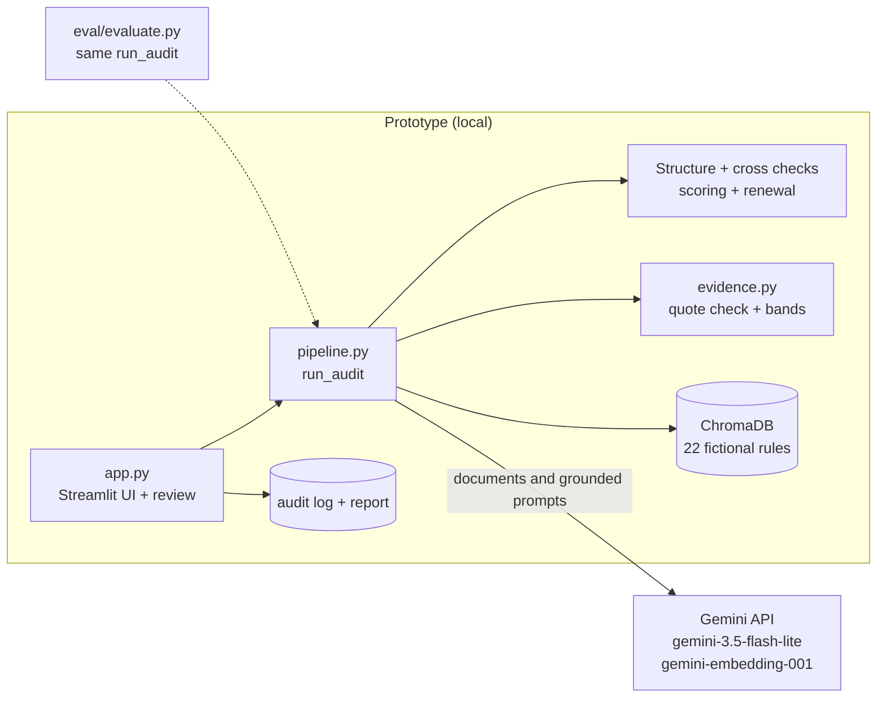
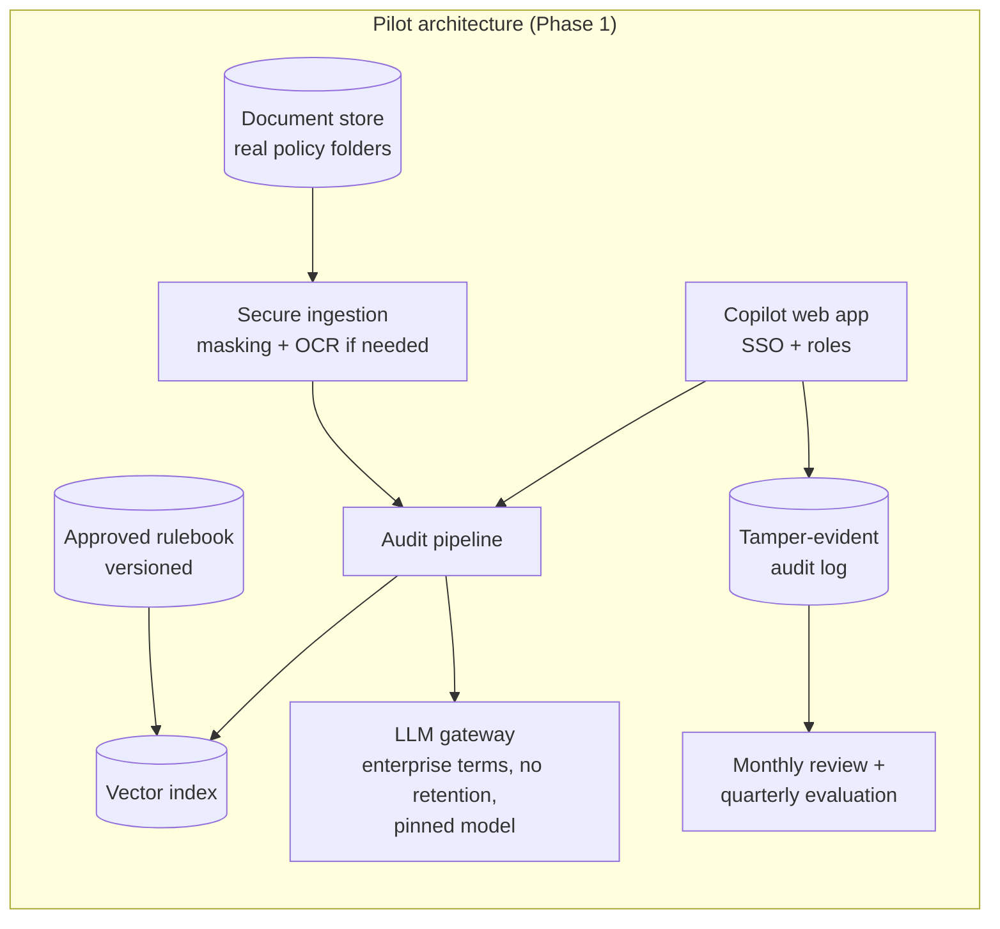

# 09 · Prototype / MVP

## Prototype type

**Local AI prototype:** a Streamlit web app with live AI calls, a ChromaDB rule index and a repeatable evaluation harness. It uses only synthetic data.

| | |
|---|---|
| Repository | [policyguard-ai/](https://github.com/MAIP2026July/TEAM011/tree/main/policyguard-ai) |
| Live demo | None: the app runs locally, and the key must stay private. It is demonstrated live in the presentation |
| Screenshots | [Appendix/Screenshots_or_Video](Appendix/Screenshots_or_Video/) |
| Video | None |
| Sample output | [Appendix/sample_audit_report.md](Appendix/sample_audit_report.md) |
| Evaluation | `python eval/evaluate.py holdout` → [eval/RESULTS.md](https://github.com/MAIP2026July/TEAM011/blob/main/policyguard-ai/eval/RESULTS.md) |
| Automated tests | `python -m pytest tests` (18 pass, using a scripted model) |

## What it demonstrates

The complete **decision loop** for one policy folder:

1. **Folder in:** choose a sample folder or upload files.
2. **AI reading:** each document is classified from its content, and key fields are extracted with quotes.
3. **Rule retrieval:** ChromaDB returns the relevant rules, and AI assesses content against them.
4. **Structure checks:** folder name, required documents, duplicates and file names.
5. **Cross-document checks:** policy numbers, date order, expired inspections, withdrawn forms, and name or address conflicts.
6. **Audit readiness:** score and status, with the reason for each deduction traceable to a finding.
7. **Renewal suggestion:** recommend renewal, manual review, hold, or no recommendation, with a rationale citing rules.
8. **Human decision:** confirm, reject or escalate each finding with a reason, then sign off.
9. **Record:** audit log and a downloadable report.

## Where exactly AI creates value

| Layer | AI technique | Value |
|---|---|---|
| Reading | Multimodal LLM with structured output | Reads digital and scanned PDFs, including signature images |
| Classification | Content-based type detection | Recognizes "App" or a differently named file as the right document |
| Retrieval | Embeddings + ChromaDB | Connects documents to rules, and allows a much larger rulebook later |
| Judgment | Grounded rule assessment | Finds incomplete documents, such as a missing exclusions section |
| Cross-document reasoning | LLM comparison | Finds conflicts in names and locations, despite abbreviations |
| Explanation | Grounded generation | Turns findings into a clear rationale |
| Guardrails (not AI) | Quote, citation and fail-closed checks | Limit the damage of AI errors |

## Architecture





The app and the evaluation call the **same `run_audit` function**, so the reported results come from the code a user runs.

## Files

```
policyguard-ai/
├── app.py                     Streamlit UI, review and sign-off
├── backend/
│   ├── pipeline.py            one audit run (used by app and evaluation)
│   ├── document_analyzer.py   AI extraction, rule assessment, folder review
│   ├── rulebook_store.py      ChromaDB RAG layer
│   ├── evidence.py            quote check and confidence bands
│   ├── structure_validator.py folder, required-document and naming rules
│   ├── cross_checks.py        policy, date, form and signature rules
│   ├── audit_engine.py        fail-closed scoring and renewal suggestion
│   ├── review_log.py          human decisions, audit log, report
│   ├── llm_client.py          the only module that calls Gemini
│   └── config.py              settings and taxonomy
├── knowledge_base/rulebook.json   22 fictional rules
├── eval/
│   ├── generate_folders.py    synthetic folders with planted defects
│   ├── evaluate.py            baseline vs PolicyGuard AI
│   ├── ground_truth.json      expected findings and renewal outcome
│   └── RESULTS.md             evaluation summary
└── tests/test_pipeline.py     18 tests with a scripted model
```

## How to run

1. Create an environment and install dependencies. If the project is in an iCloud-synced folder, keep the virtual environment outside it, because the synced folder made imports extremely slow on my machine.
   ```bash
   python3.13 -m venv ~/.venvs/policyguard-ai
   ~/.venvs/policyguard-ai/bin/pip install -r requirements.txt
   ```
2. Put `GEMINI_API_KEY=...` in `policyguard-ai/.env`.
3. **Demo:** from `policyguard-ai/`, run `~/.venvs/policyguard-ai/bin/python -m streamlit run app.py`.
4. **Evaluation:** `~/.venvs/policyguard-ai/bin/python eval/evaluate.py holdout`.

## Demo script (3 minutes)

| Step | Input | What to point out |
|---|---|---|
| 1 | `holdout / POL200007` | Scanned legacy folder. **Fail, 65/100, Hold.** Valid file names, but wrong policy number and date order are found inside. A file-name script finds nothing here. |
| 2 | Open F001 | Rule, quote, "no text layer", and why confidence is only MEDIUM |
| 3 | Decide findings; show Sign off disabled | **A person decides.** A reason is needed, and the renewal decision starts blank |
| 4 | Sign off and download report | Audit trail and evidence-linked report |
| 5 | Clear the API key and run again | **Not Scored.** "My first prototype said 100/100 here. Fixing that was the most important change." |

## What it does not yet prove

- **Real-world accuracy.** The test folders are synthetic, single-page and tidy, and one AI-assisted process produced the rules, documents and defects.
- **Repeatability.** One finding changed between runs of the same folder. This has not been measured formally.
- **Time savings and audit outcomes.** Only the Phase 0 time study and the pilot can show these.
- **Model choice.** One model was tested because of free-tier limits.
- **RAG value at scale.** A 22-rule rulebook is too small to show the benefit.
- **Guardrails in live use.** LOW confidence and citation rejection have run only in tests with a scripted model.
- **Full evidence checks on scans.** Quotes from scans cannot be verified automatically, and a separate OCR service was not used.
- **Renewal eligibility.** Criteria cover documents and risk grade, not claims history or premium.
- **True folder trees.** The prototype checks the folder name and a flat file list, not nested subfolders.
- **Word documents.** Upload covers PDF and images only.
- **Security.** No SSO or role-based access; the audit log is a plain file; the API key field is for demos. The free tier must never be used for real data.

## Why this prototype and not a chatbot

There is **no chat box**. The product is built around one decision moment: it shows evidence and confidence, refuses to score what it could not analyse, and records the human decision. I kept it narrow because reviewer trust and fit with the workflow, not model capability, are the open questions.
