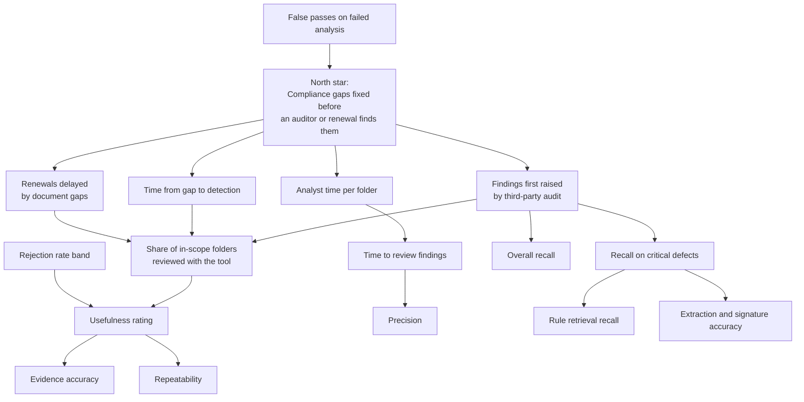

# Metric Tree

Model metrics matter only when they connect to business outcomes.

| Level | Metric | Prototype result (synthetic holdout) | Pilot target |
|---|---|---|---|
| Business | Findings first raised by auditors | Not measured | Trend down |
| Business | Time from gap to detection | Not measured | Falling |
| Business | Renewals delayed by gaps | Not measured | Trend down |
| Product | Analyst time per folder | Not measured | −40% |
| Product | Adoption | Not measured | ≥ 80% |
| Model | Recall on critical defects | 3 of 3 | ≥ 95% |
| Model | Overall recall | 16 of 16 | ≥ 85% |
| Model | Precision | 94.1% | ≥ 70% |
| Model | Rule retrieval recall at 10 | 100% | ≥ 98% |
| Trust | Fabricated evidence | Not audited by a person | 0 of 100 |
| Trust | Repeatability | Not measured formally; variation seen | ≥ 95% |
| Trust | False passes on failed analysis | 0 | 0 |
| Trust | Usefulness | Not measured | ≥ 70% |
| Trust | Rejection rate | Not measured | 10–40% |

**Reading the table:** model metrics exist today only on synthetic data. Every business metric still needs the pilot.
