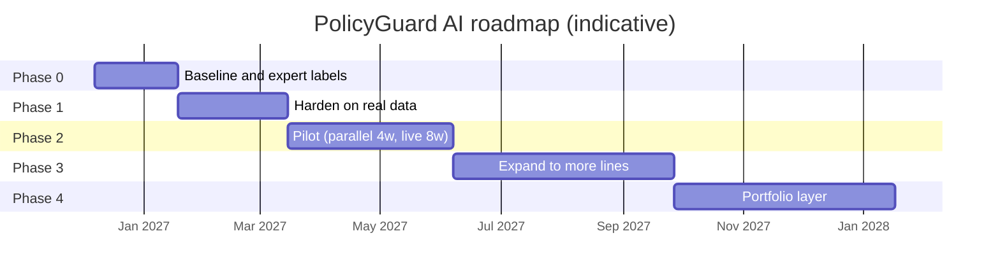

# Roadmap with Proof Gates

This is the roadmap from the PM Artifact Pack, kept here as a stand-alone artifact. Dates are indicative.

Each phase has to earn the next. Work moves on only when the gate in the table below is met, so **staged learning and proof gates** set the pace, not the calendar.

| Phase | What it must achieve | Gate to the next phase |
|---|---|---|
| **0. Baseline** (6 wks) | Establish how long reviews take now, and write the real rules down | Time study of 30 folders; approved rulebook; privacy approval for test data; 300 folders labeled by 2 experts (agreement ≥ 0.7) |
| **1. Harden on real data** (8 wks) | Show that reading works on real documents | All offline gates in [05 §9](../../02_Final_Report.pdf): critical recall ≥ 95%, overall recall ≥ 85%, precision ≥ 70%, 0 fabricated evidence in 100 audited findings, repeatability ≥ 95%, retrieval recall ≥ 98%, security and privacy sign-off |
| **2. Pilot** (12 wks) | Test workflow value and trust. Analysts first run the tool in parallel with normal work (**shadow mode**), then use it live | ≥ 40% less analyst time; ≥ 70% useful; rejection rate 10–40%; no serious incident |
| **3. Expand** (16 wks) | Add other lines, bulk scan and a recurring-issue view | Metrics hold across lines; a funded owner; run cost within budget |
| **4. Portfolio** | Shared compliance layer across portfolios | Needs its own business case |

**Rollback rule.** In any phase, a fabricated finding in an audit submission, a critical miss traced to the tool, or a data breach sends the product back to shadow mode.

